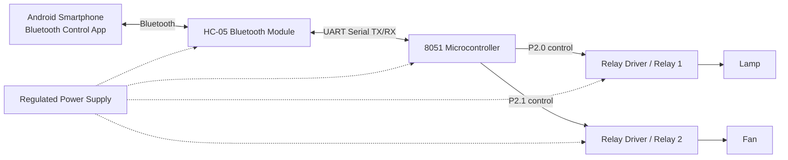
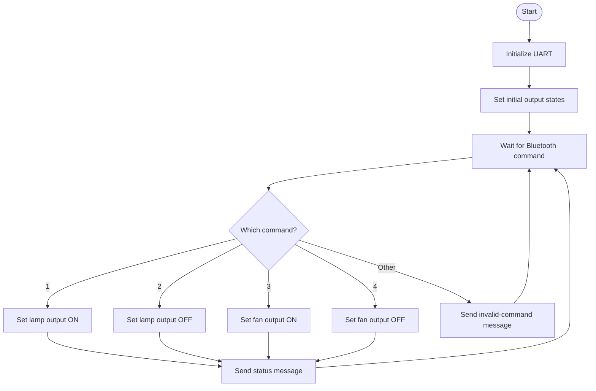

Bluetooth Controlled Home Automation Using 8051 Microcontroller
A simple embedded-systems project that lets a user control home appliances from an Android smartphone over Bluetooth. An HC-05 Bluetooth module receives commands from the phone and passes them to an 8051-family microcontroller through UART serial communication. The microcontroller controls the lamp and fan outputs.
Features
Wireless control from an Android phone over Bluetooth
8051 microcontroller-based control logic
HC-05 Bluetooth serial communication
UART transmit and receive routines
Separate commands for lamp and fan control
Text status response for each recognized command
Block Diagram
GitHub supports Mermaid diagrams, so this diagram should render directly in the repository README.

Signal flow: The Android app sends a command to the HC-05. The module forwards it to the 8051 using UART. The microcontroller checks the command and changes the lamp or fan control output. A status string is sent back over the serial connection.
> The diagram is a functional block diagram, not a detailed wiring schematic. Confirm your exact development-board and relay-module connections before building the circuit.
Command / Program Flowchart

Hardware Requirements
8051-family microcontroller development board
HC-05 Bluetooth module
Relay driver / relay module suitable for the intended loads
Lamp and fan, or low-voltage demonstration loads
Regulated power supply suitable for the board and modules
Jumper wires and connecting wires
Android smartphone with a Bluetooth serial-control app
> **Electrical safety:** Never connect a mains-powered appliance directly to a microcontroller pin or bare relay. Use a properly rated, isolated relay module and a safe enclosure. For mains wiring, use a qualified person. For development and testing, low-voltage loads are safer.
Software Requirements
Keil µVision / C51 — compile the 8051 C source
Nuvoton ISP-ICP Utility — if required by your specific Nuvoton board
Android Bluetooth control app — send serial characters from the phone
HyperTerminal or another serial terminal — optional debugging tool
How It Works
Pair the Android phone with the HC-05 module. The presentation lists common default PINs as `1234` or `0000`; the actual PIN may differ.
The app sends a single-character command over Bluetooth.
The HC-05 forwards the character to the microcontroller through UART.
The 8051 program reads the character and updates the relevant output.
The program sends a status string back over UART.
Bluetooth Commands
Command	Intended action	Status text
`1`	Lamp ON	`Lamp_ON`
`2`	Lamp OFF	`Lamp_OFF`
`3`	Fan ON	`Fan_ON`
`4`	Fan OFF	`Fan_OFF`
Any other character	No appliance action	`Select proper option`
The presentation's code sets the output pins to logic `1` for the ON commands and logic `0` for the OFF commands. Relay boards can be active-low or active-high, so verify your relay module and adjust the logic for your actual hardware.
Pin / Interface Summary
Signal	Pin / connection
Lamp control	P2.0
Fan control	P2.1
8051 UART receive	P3.0 / RXD on a standard 8051
8051 UART transmit	P3.1 / TXD on a standard 8051
HC-05 serial link	Cross-connect module TX to MCU RX and module RX to MCU TX
Ground	Use a common ground where required by the board/module design
Important: The presentation's code comment appears to label the UART pins in the opposite order. On a standard 8051, P3.0 is RXD and P3.1 is TXD. Confirm the pinout for your exact board and check voltage-level compatibility before wiring.
Connection Overview
```text
Android phone
     )) Bluetooth ((
   HC-05 module
     TX  ------------>  8051 P3.0 / RXD
     RX  <------------  8051 P3.1 / TXD
                         |
                         | P2.0
                         v
                  Relay driver 1 ---> Lamp

                         | P2.1
                         v
                  Relay driver 2 ---> Fan
```
This is a simplified signal overview, not a complete circuit schematic. Power, ground, relay-driver inputs, isolation, and load wiring depend on the specific modules being used.
Setup
Assemble the circuit using the documentation for your exact microcontroller board, HC-05 module, and relay module.
Open the 8051 C source in Keil µVision.
Confirm the MCU model, oscillator frequency, UART baud rate, output polarity, and pin mapping.
Compile the program and resolve any compiler errors.
Program the microcontroller using the tool supported by your board.
Power the circuit and pair the phone with `HC-05`.
Open a Bluetooth serial-control app and connect to the paired module.
Send `1`, `2`, `3`, or `4` and check the response.
Test using low-voltage loads before connecting any actual household appliance.
Code Overview
The C program shown in the project presentation uses:
`UART_Init()` — configures the serial port and Timer 1
`UART_TxChar()` — transmits one character
`UART_RxChar()` — receives one character
`UART_SendString()` — transmits a status message
`main()` — continuously receives commands and controls the lamp/fan outputs
The code uses `#include <reg51.h>` and declares the outputs as `sbit Lamp = P2^0;` and `sbit Fan = P2^1;`. The presentation shows `TH1 = 0xFD`, commonly used for 9600 baud with a suitable 8051 clock configuration; verify the clock and baud-rate settings for your hardware.
Troubleshooting
Phone cannot connect: Check that the HC-05 is powered, paired, and not connected to another device.
Commands do not work: Check TX/RX crossover, baud rate, ground, and voltage-level requirements.
Lamp/fan state is reversed: Check whether the relay module is active-low or active-high.
Serial text is garbled: Confirm the MCU clock and UART baud rate match the Bluetooth serial settings.
Programming fails: Confirm the MCU model and use the programming utility supported by the development board.
Suggested Repository Structure
```text
Bluetooth-Home-Automation-8051/
├── README.md
├── src/
│   └── home_automation.c
├── diagrams/
│   ├── block-diagram.png
│   ├── flowchart.png
│   └── circuit-diagram.png
└── docs/
    └── project-presentation.pptx
```
The folder names above are suggestions. Add only files you actually have. Mermaid diagrams in this README do not require separate image files.
Limitations
This project provides local Bluetooth control; it does not provide Wi-Fi or internet-based remote access.
The presentation does not specify every board model, circuit connection, or relay-driver detail. Confirm these against the actual hardware.
The code shown in the presentation may need syntax cleanup and hardware-specific changes before it compiles and runs.
Future Improvements
Add appliance-state sensing so the status reflects the actual load state.
Add more output channels for additional appliances.
Improve command validation and add error handling.
Include tested source code, real circuit photographs, and a detailed schematic.
License
Choose a license before publishing the project publicly. If you want others to reuse and modify the code, consider adding a license file such as MIT after confirming you have the right to license all included material.
